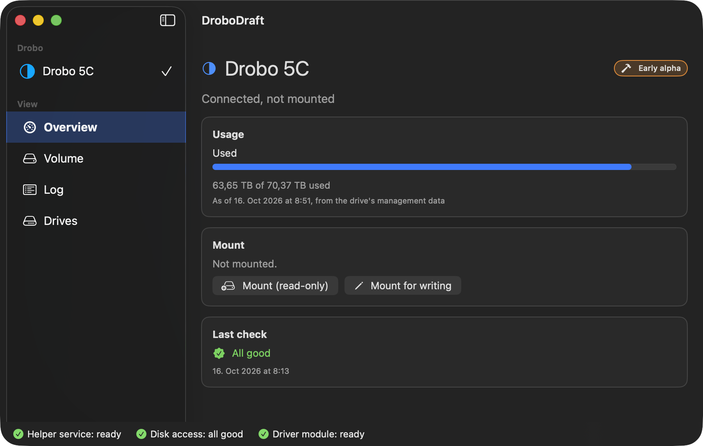

# DroboDraft

**Use a Drobo 5C on a current Mac, read and write, without a kernel extension.**

> **For developers only, for now.** You have to build and sign it yourself with your own Apple Developer account (details under Requirements). There is no download.
>
> **Early alpha (0.1.0).** Developed and tested on one Drobo 5C (USB, HFS+, 64 TB volume) with macOS 26.5.1 on Apple Silicon. No other Drobo model and no other Mac has been tried. Writing to a disk without a second copy of your data is at your own risk. DroboDraft does not (yet) show drive bay status or redundancy warnings, so it does not tell you when the Drobo loses protection.



The internal project name is *DroboFSProbe* ("FS probe" is a leftover from early experiments): the build, the folder `fskit_probe` and `/Applications/DroboFSProbe.app` still use it, while the app shows itself as *DroboDraft*.

## The problem

Drobo devices are no longer supported; the Drobo Dashboard and its drivers do not work on current macOS. A Drobo 5C still shows up as a USB disk and can usually be *read*. **Writing** hangs or disconnects the device: macOS sends write commands of up to 1 MiB over USB 3, but the Drobo 5C only copes with commands up to 512 KiB, and macOS offers no supported way to lower that limit for a USB disk without a kernel extension.

## What DroboDraft does

- **Mounts the Drobo through its own file system module** (FSKit, runs in user space) that never sends a device write larger than 512 KiB (524,288 bytes). Reading: 183.7 MB/s through the module against 191.6 MB/s through the macOS kernel driver, on the same list of 16 files.
- **Read-only by default.** Mounting for writing is a separate action.
- **Backs up the file system's bookkeeping ("management data": the structures that say where every file lives, not the files themselves) before every write session** (catalog, extents, attributes, allocation bitmap, volume headers: about 3.2 GB and about 19 seconds for a 64 TB volume). If the backup fails, nothing is mounted for writing. The volume is **checked after unmounting** (read-only: volume headers, journal, allocation bitmap).
- **Restore backup:** puts a saved copy of the management data back. It starts with a dry run that writes nothing, then asks for a second confirmation. Everything written since that backup is lost.
- **Safe unplug:** if the Drobo disappears while mounted for writing, DroboDraft warns you and checks the volume before the next mount.
- **Back up folder:** copies a folder from the Drobo to another disk, incremental, every copy verified with SHA-256.
- A **Check disk access** button that tells you whether macOS lets the helper reach the drive, a **Help** window, a menu bar item, notifications, a read speed test, Shortcuts actions, **Open at login**, a sidebar with several Drobos.
- No write speed figure is published yet; only the read measurement above exists.
- The interface follows the system language: English or German.
- No Drobo Dashboard, no kernel extension, no lowered system security level. It does need three permissions you grant in System Settings (file system module, background helper, Full Disk Access for the helper), described under Install.

**Not yet available:** drive bay status, protection level, warnings and the real free space (the Drobo reports a virtual 64 TB size; the app shows what the file system reports). Only the Drobo 5C has been tested.

## Requirements

- macOS 26 or later (tested: 26.5.1), Apple Silicon (tested: M4 Pro).
- A Drobo 5C connected by USB, with an **HFS+** volume.
- Xcode and [XcodeGen](https://github.com/yonaskolb/XcodeGen) (`brew install xcodegen`). There is no ready-made download yet; you build the app yourself.
- **A paid Apple Developer account, today.** The file system module must be signed with Apple's FSKit entitlement, and the helper only accepts calls from binaries signed by your team. There is no notarized release build yet. DroboDraft has applied to Apple for permission to distribute one; there is no date. Until then you need your own signing identity. Whether a free Apple ID (Personal Team) is enough has **not been tested**.

## Install

The project is wired to its author's signing team and bundle identifiers, so you must change them first. This is the roughest part of the alpha; none of it has been tried on a second Mac.

1. **Use your team and identifiers.**
   - Put your 10-character team ID into `DEVELOPMENT_TEAM` in `fskit_probe/project.yml`, and into `teamID` in `drobo_kern/Sources/DroboKern/HelferLogik.swift` (the helper compares callers against it).
   - The bundle identifiers `de.begod.*` belong to the author's team and cannot be signed by yours. Replace that prefix with your own (about 60 occurrences; find them with `grep -rl "de\.begod" --exclude-dir=build --exclude-dir=docs --exclude-dir=dext_probe .`, where `docs` is notes and `dext_probe` an unrelated experiment; one file is also *named* `de.begod.drobohelper.plist`).
2. **First build and install by hand.** (The update script in step 4 refuses to run until the module is enabled, and the module can only be enabled once the app is installed.) `make` builds Apple's HFS code into a static library that the module links:
   ```bash
   make
   cd fskit_probe && xcodegen generate
   xcodebuild -project DroboFSProbe.xcodeproj -scheme DroboFSProbe -configuration Debug \
     -derivedDataPath ~/DroboDraftBuild -allowProvisioningUpdates build
   rsync -a --delete ~/DroboDraftBuild/Build/Products/Debug/DroboFSProbe.app/ /Applications/DroboFSProbe.app/
   ```
3. **Enable the module:** System Settings → General → Login Items & Extensions → *File System Extensions* → switch on the DroboDraft module. If the switch does not stay on, restart the Mac and check again.
4. **Later updates only:** the script, which rebuilds and replaces the app in place so the module stays enabled. Set `DD` to the build folder you want (the default is a folder on the author's disk):
   ```bash
   cd fskit_probe && DD=~/DroboDraftBuild bash tools/install_module.sh
   ```
   The script never changes system settings. If the module is not enabled it stops with exit code 3 and says so.
5. **Allow the helper:** open `/Applications/DroboFSProbe.app` once, then System Settings → General → Login Items & Extensions → *Allow in the Background* → enable the Drobo helper service.
6. **Give the helper Full Disk Access:** System Settings → Privacy & Security → Full Disk Access → **+** → press ⌘⇧G and enter `/Applications/DroboFSProbe.app/Contents/MacOS/drobohelper`. Without it macOS does not let a background helper hand a USB disk's device to you. The status bar shows *Disk access: all good* when it works. (The "Driver module" in the status bar is this user-space file system module, not a kernel extension.)
7. **Choose a backup location:** Settings (⌘,) → *Backup location*, before your first write session (see Use). It needs a disk that is neither the startup volume nor the Drobo, with a few GB free.
8. **Tell DroboDraft which disk is your Drobo.** Under *Drives* (or Settings, ⌘,) add it with a name and its **volume identifier**: the volume UUID of the Drobo's HFS+ volume. With the Drobo connected, `diskutil info -all` lists it as *Volume UUID*. The helper only ever releases the device of a volume you added.

**Uninstall:** quit the app, switch off the module and the helper in System Settings, delete `/Applications/DroboFSProbe.app`, remove its entry under Full Disk Access, and delete the backup folder if you no longer need it.

## Use

Open **DroboDraft**, select your Drobo and click **Mount (read-only)** or **Mount for writing**. Mounting for writing first makes and verifies the management data backup, so choose a *Backup location* in Settings before your first write session. It must not be on the startup volume or on the Drobo. The built-in default points to a folder that exists only on the author's machine.

Always click **Unmount Drobo**, not eject in the Finder, so that the check runs right away. A mounted Drobo appears in Finder under *Locations*; a setting can hide it (then use **Open in Finder**).

If you mount for writing, consider excluding the Drobo from Spotlight and Time Machine in System Settings. The app only reminds you and changes nothing.

### Command line

The core has a command line tool, `drobo` (`cd drobo_kern && swift build -c release`). Its commands and messages are German only; English meaning in the comments:

```bash
drobo status              # connection, mount state, module and helper
drobo einhaengen          # mount read-only (add --schreiben to mount for writing)
drobo aushaengen          # unmount and check
drobo sichern             # management data backup only (volume must be unmounted)
drobo sicherungen         # list backups, newest first
drobo zurueckspielen NAME # restore: dry run; add --ausfuehren to really write
drobo zugriff             # check helper access to the drive, no side effects
```

The helper accepts only binaries signed by your team, so sign the CLI with your own identity:

```bash
DROBO_SIGNATUR="Apple Development: Your Name (TEAMID)" B=~/DroboDraftBuild/kern bash fskit_probe/tools/sign_cli.sh   # run from the repository root
```

`DROBO_SIGNATUR` is the name of a code signing identity (`security find-identity -v -p codesigning` lists yours). `B` is the build folder (the default is a folder on the author's disk). The script prints the path of the signed binary.

## How it works

```
Finder / apps
     │  file operations
     ▼
FSKit module "hfsdrobo"   Apple's livefiles HFS+ code, every device write ≤ 512 KiB
     │  block reads and writes
     ▼
/dev/diskNsM              Drobo 5C via USB
```

- **Module** (`fskit_probe/Module`): an FSKit file system extension built on Apple's open source `livefiles_hfs` (hfs-715.100.10). One code path writes to the device and caps every command at 524,288 bytes; `make check-io` verifies that no other write path is linked in. The read path is tuned for slow devices (per-file extent cache, B-tree node cache).
- **Helper** (`fskit_probe/Helper`): a small privileged service. It hands the Drobo's device node to the logged-in user and back, and creates and removes the mount folder. It accepts calls only from DroboDraft's own signed binaries and only for volumes you added.
- **Core** (`drobo_kern`): a Swift package with the logic (find, check, mount, back up, restore, verify, copy) and the `drobo` tool; its tests run against disk images. An optional deeper catalog check after unmounting uses a Python script that is not part of this repository; without it the app still checks volume headers, journal and allocation bitmap.

## Safety and limits

- Keep your own backup of anything you cannot lose. The management data backup protects the file system structure, not your files, and only for the write session it was taken before.
- The app's own check only reads. Do not run `fsck_hfs` with repair options on the Drobo unless you know what you are doing. Even `fsck_hfs -n` opens the device for writing.
- Only the Drobo 5C has been tested, only with a 64 TB HFS+ volume.
- Early alpha: features and the interface still change; not meant for continuous use.

## License

MIT for this project's code (SPDX: `MIT`, see [LICENSE](LICENSE)). Apple's HFS code in `vendor/hfs-715.100.10/` is under the Apple Public Source License 2.0 (SPDX: `APSL-2.0`, see [APPLE_LICENSE](vendor/hfs-715.100.10/APPLE_LICENSE)); changes to it are listed in `livefiles_shim/INVENTAR.md`.

DroboDraft is provided as is, without warranty of any kind, and is not affiliated with Drobo, StorCentric or Apple. Development notes (in German) are in `docs/`.
